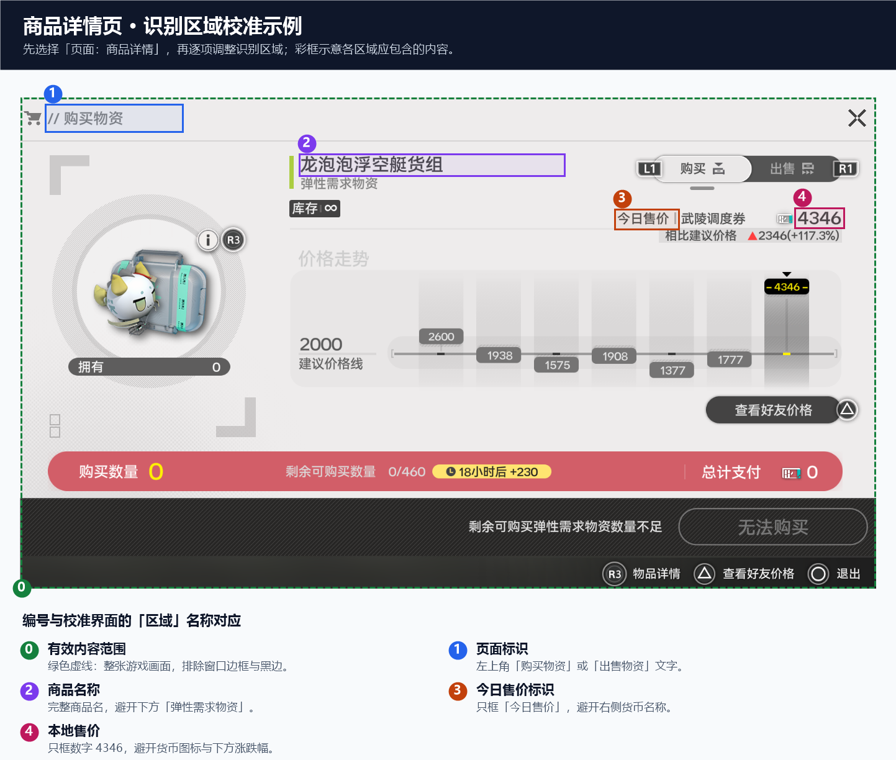
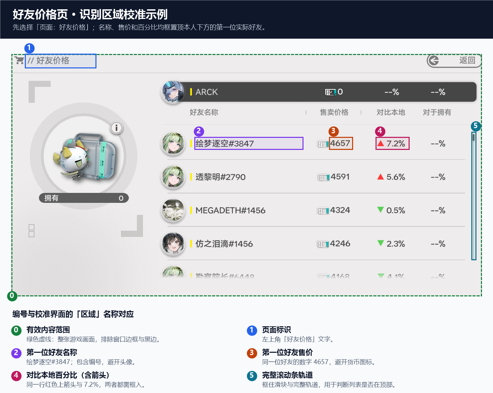

# 识别区域校准示例

在「调整识别区域」中选择对应的「页面」和「区域」，对照下图拖动、缩放识别框。图中编号仅用于说明，区域名称与校准界面一致；彩框示意各区域应包含的内容，实际位置需根据自己的游戏画面调整。

## 商品详情页

## 好友价格页

好友名称、售价与百分比必须来自同一位好友。采集时保持好友列表顶部。只有短列表确实没有滚动条时，也就是好友数量不足时，才勾选「好友列表右侧没有滚动条」。