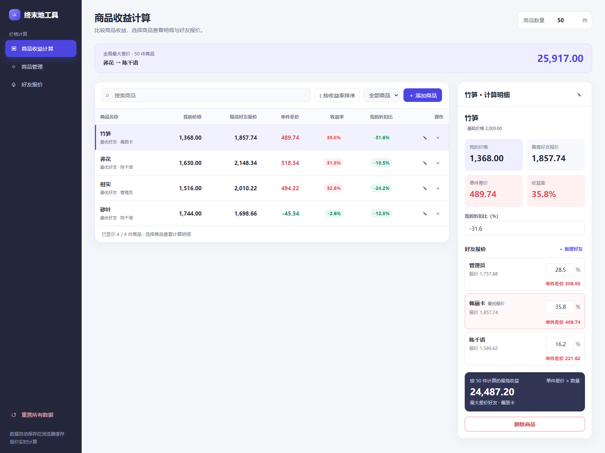
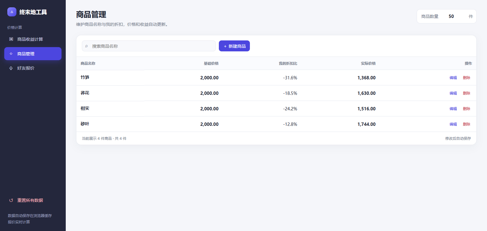
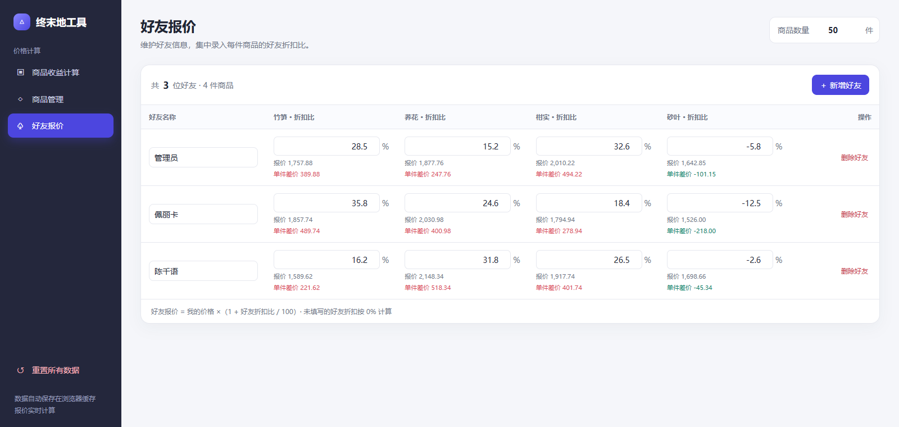
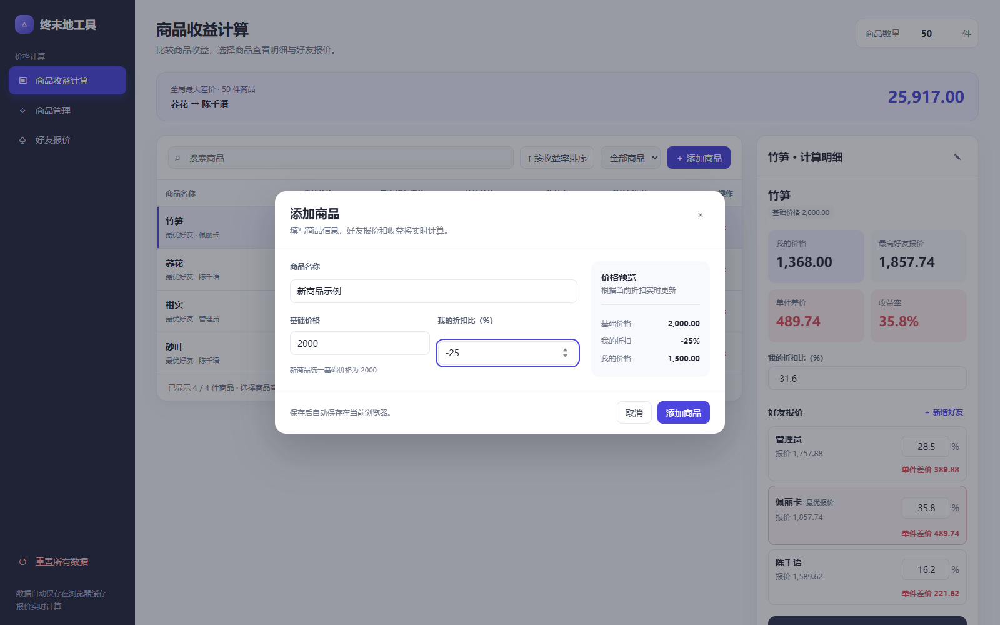

# Endfield-Friend-Price-Difference-Calculator

<p align="center">
  
</p>

《明日方舟 终末地》物资调度 弹性需求物品 好友价格差价计算器

本项目为玩家制作的免费辅助工具，与《明日方舟：终末地》官方无关联。

## OCR 图片导入

在「商品管理」中点击「图片导入」，可以从游戏截图中识别商品名称、售价和我的折扣比，减少手动录入。

图片仅在本机浏览器中处理，不会上传至服务端。Tesseract.js、WebAssembly 内核和中英文模型随站点提供，首次识别需要加载这些资源，耗时取决于网络与设备性能。推荐使用清晰、完整的游戏截图，拍照、反光、模糊或遮挡可能降低准确率，导入前请核对结果。

## 本地运行

使用静态 HTTP 服务打开 `docs/` 目录，例如在项目根目录执行：

```sh
python -m http.server 8000 --directory docs
```

然后在浏览器中访问 `http://localhost:8000`。OCR 依赖 Web Worker 和 WebAssembly，请通过 HTTP/HTTPS 访问页面。

## 游戏采集（实验性功能）

面向同一台 Windows 电脑上的游戏和 Edge / Chrome,画面在本机处理，无需服务器识别或桌面客户端。

1. 先在商品管理中建立商品，并保留计算器中自己的本地价格。
2. 在「好友报价」点击「游戏采集」。等待模型预热完成，再主动点击「开始采集 / 选择窗口」，在浏览器中选择游戏窗口。模型预热不会自动弹出共享选择框。
3. 首次使用先检查预览，需要时点击「调整识别区域」冻结画面。分别在商品详情和好友价格页校准页面标识、名称、价格等区域；拖动方框移动、拖动右下角缩放，也可以输入 0～1 坐标。有效内容范围用于排除窗口边框。好友名称和售价只框置顶本人下方的第一位实际好友，避开货币图标；滚动位置区域框完整滚动条。短列表确实无滚动条时才能选择「好友列表右侧没有滚动条」。保存后在同一站点复用配置。
4. 回游戏，先打开商品详情短暂停留，再打开好友价格页并保持列表顶部。每页建议至少停留 3 秒；工具只读取画面，不会替你点击或滚动。返回详情后再切换下一件商品。
5. 回网页点击「停止并核对」，或通过浏览器结束共享。停止会结束共享及 OCR，已采结果与文字小截图保留在核对表。修正所属商品、实际好友名称、整数售价，勾选要导入的行；异常默认不勾选，同商品的两个冲突候选只能选择一个。
6. 点击「核对并保存报价」。仅更新勾选商品的专用「游戏采集」报价；实际游戏好友名作为备注，不创建每一位真实好友，不修改商品本地价。重采覆盖对应商品，其他采集记录和手填报价保留。

「游戏采集」好友价格，与手动填写的好友价格共同参与最高报价和收益计算。本地折扣改变时采集售价不变，收益按新本地价计算。好友管理可以修改售价、备注、清除单项或删除整个采集好友；手动修正标记「已手动修改」并保留原采集时间。

## UI展示


### 商品收益计算

对比商品价格、单件差价与收益率，查看所选商品的好友报价和指定数量下的最高收益。



### 商品管理

集中查看商品基础价格、我的折扣比与实际价格，支持新建、编辑和删除商品。



### 好友报价

按好友录入各商品的折扣比，实时查看报价与单件差价。



### 添加商品

填写商品名称和我的折扣比，保存前可预览实际价格。



## 开发文档
[开发文档](./DEVELOPMENT.md)

## 第三方组件与版权

OCR 使用 Tesseract.js 6.0.1、tesseract.js-core 6.0.0 及简体中文、英文语言模型，相关组件采用 Apache License 2.0；内核和脚本中包含的其他第三方代码分别遵循其原始许可证。

