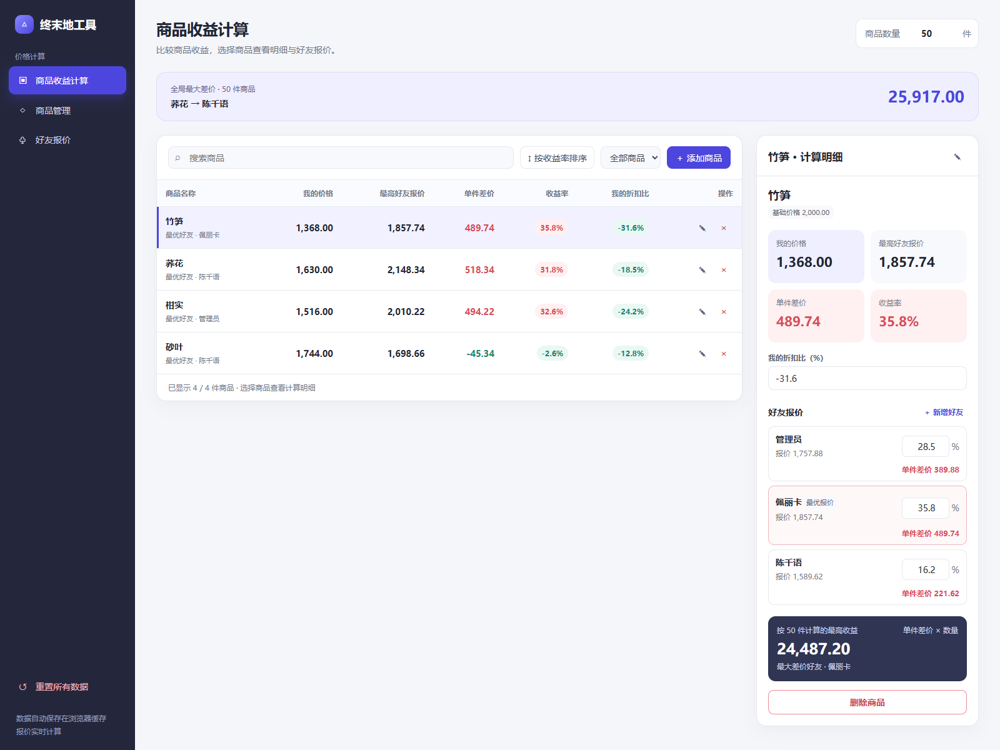
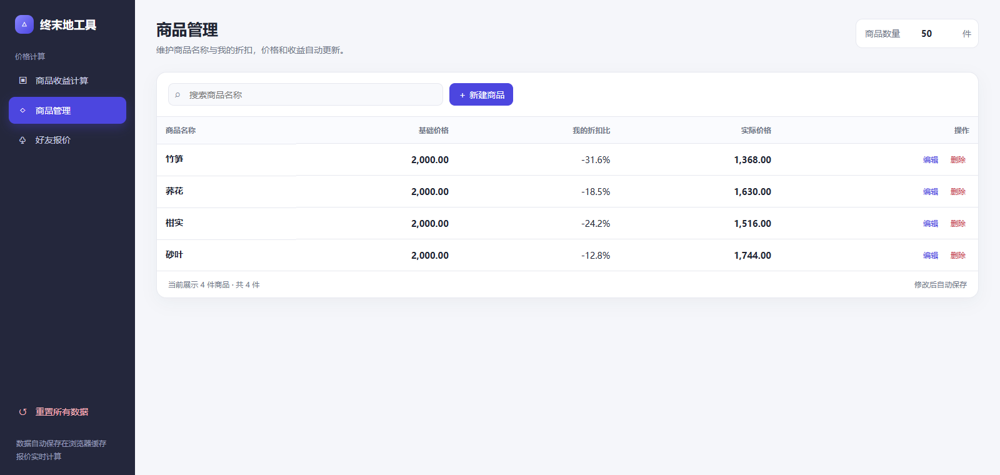
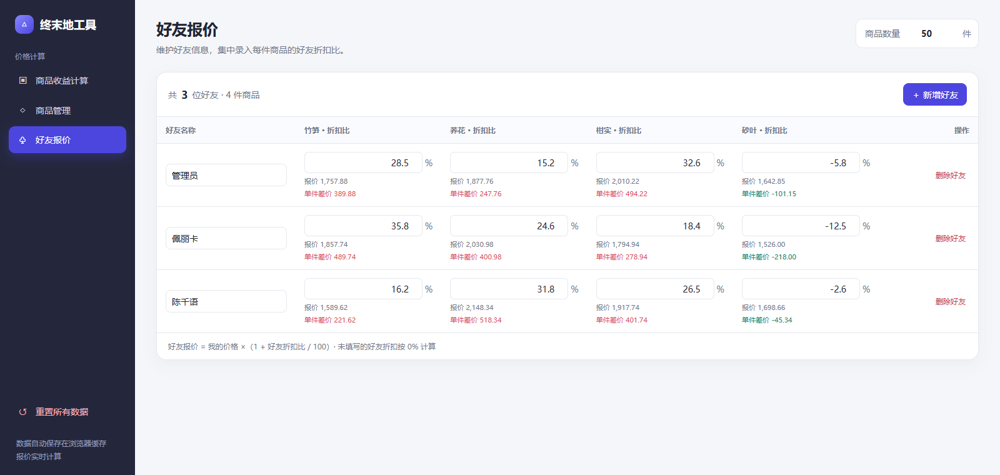
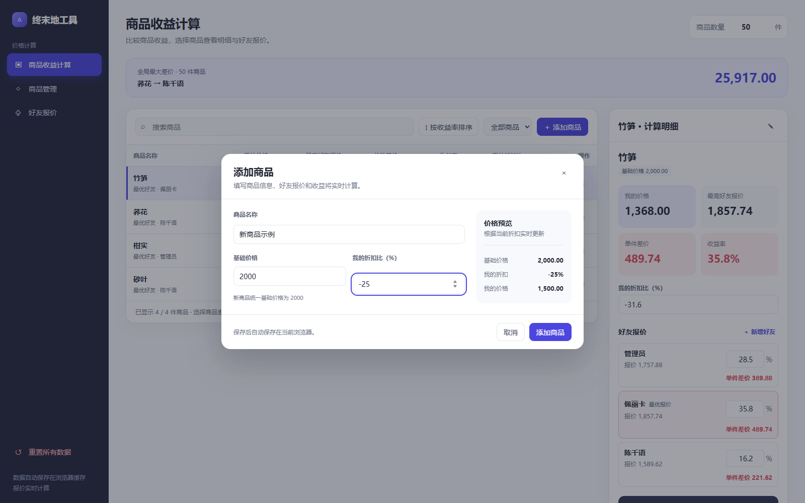

# Endfield-Friend-Price-Difference-Calculator

《明日方舟 终末地》物资调度 弹性需求物品 好友价格差价计算器

## OCR 图片导入

在「商品管理」中点击「图片导入」，可以从游戏截图中识别商品名称、售价和我的折扣比，减少手动录入。

图片仅在本机浏览器中处理，不会上传至服务端。Tesseract.js、WebAssembly 内核和中英文模型随站点提供，首次识别需要加载这些资源，耗时取决于网络与设备性能。推荐使用清晰、完整的游戏截图，拍照、反光、模糊或遮挡可能降低准确率，导入前请核对结果。

## 本地运行

使用静态 HTTP 服务打开 `docs/` 目录，例如在项目根目录执行：

```sh
python -m http.server 8000 --directory docs
```

然后在浏览器中访问 `http://localhost:8000`。OCR 依赖 Web Worker 和 WebAssembly，请通过 HTTP/HTTPS 访问页面。

## UI展示


### 商品收益计算

对比商品价格、单件差价与收益率，查看所选商品的好友报价和指定数量下的最高收益。



### 商品管理

集中查看商品基础价格、我的折扣比与实际价格，支持新建、编辑和删除商品。



### 好友报价

按好友录入各商品的折扣比，实时查看报价与单件差价。



### 添加商品

填写商品名称和我的折扣比，保存前可预览实际价格。



## 开发文档
[开发文档](./DEVELOPMENT.md)

## 第三方组件与版权

OCR 使用 Tesseract.js 6.0.1、tesseract.js-core 6.0.0 及简体中文、英文语言模型，相关组件采用 Apache License 2.0；内核和脚本中包含的其他第三方代码分别遵循其原始许可证。

